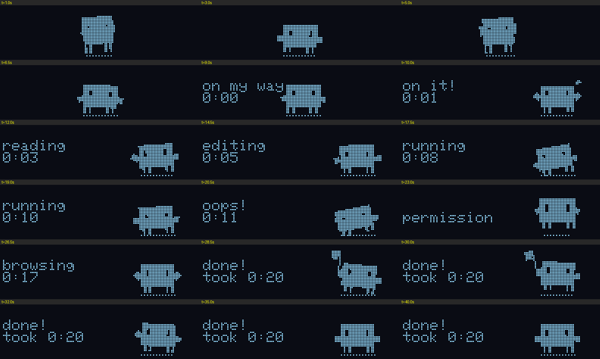
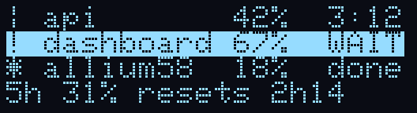
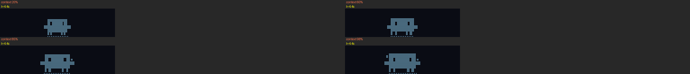

# allium58-claude

Turns the two OLEDs on a [beekeeb Allium58](https://beekeeb.com) split keyboard
into a live dashboard for [Claude Code](https://claude.com/claude-code).

- **Left screen:** a pixel Claude mascot that reacts to each session event:
  reading, editing, running, browsing, permission prompts, errors, "done!". It
  gets visibly fuller as the context window fills up, and gets bored or falls
  asleep when you stop typing.
- **Right screen:** one row per active Claude Code session, showing its state,
  context %, and turn timer. Rows that need your permission are highlighted.
  Spare rows show your 5-hour usage window and today's spend.


| Left screen through one turn | Right screen |
|---|---|
|  |  |

The mascot gets fuller as context fills up (20 / 60 / 85 / 98 %):



The images are rendered by `tools/sim.c`, which runs the real firmware drawing
code on your Mac. The right-screen image is a mock of the bridge's row format.

## How it works

```
Claude Code ──hooks + statusLine──▶ host/agentd.py ──raw HID──▶ left half ──split RPC──▶ right half
             (curl to 127.0.0.1:8738)   (launchd agent)        (mascot, USB)            (sessions)
```

1. Each Claude Code hook event (`SessionStart`, `UserPromptSubmit`,
   `PreToolUse`, `Stop`, …) and the status line payload are sent to a small
   local HTTP server, `host/agentd.py`.
2. The bridge keeps a table of live sessions. It sends the keyboard only what
   has changed, over VIA's raw HID interface, using its own command ids
   (`0xC1`–`0xC6`, `0xCF`).
3. The left half (the one on USB) animates the mascot. It mirrors the
   sessions screen to the right half over a QMK split RPC.

The bridge also prints Claude Code's status line
(`model · ctx 42% · $1.20 · 5h 31%`).

## Requirements

- beekeeb Allium58 (RP2040, two 128×32 OLEDs)
- macOS (the bridge uses launchd; the Python itself is portable)
- Python 3 and the [QMK CLI](https://docs.qmk.fm/newbs_getting_started)
- Claude Code

## Setup

```bash
git clone https://github.com/alminisl/allium58-claude ~/allium58   # the scripts expect this path
cd ~/allium58
./build.sh      # clones vial-qmk at the tested commit, applies the patch, builds allium58_claude.uf2
```

**Flash both halves.** Plug the cable into one half, double-tap reset, and copy
`allium58_claude.uf2` onto the `RPI-RP2` drive. Then do the same for the other
half. After the first flash, `./flash.sh` reflashes the half on the cable
without the reset button.

> Both halves must run the same build. The left half sends the sessions screen
> to the right half as a split RPC. If the right half runs an older build, it
> stays on "waiting for Claude".

**Start the bridge and connect Claude Code:**

```bash
./install.sh    # venv with hidapi + launchd agent com.allium58.agentd
```

Then merge `host/claude-settings.example.json` into `~/.claude/settings.json`.
It adds the `statusLine` and one `curl` hook per event. Start a new Claude Code
session and the screens come alive.

## Daily use

| | |
|---|---|
| `host/bridge pause` / `resume` / `status` | Release the keyboard (for example, for [vial.rocks](https://vial.rocks)) and take it back |
| `./build.sh && ./flash.sh` | Rebuild and reflash without the reset button |
| `host/watch.sh` then `tail -f host/watch.log` | USB and bridge health timeline |
| `host/layout.py save` / `check` | Fingerprint your Vial keymap and check it survived a flash |

The bridge lets go of the keyboard on its own while the Vial desktop app is
running.

## Repo layout

```
firmware/claude/       QMK/Vial keymap: keymap.c (HID protocol, split sync), clawd.c (mascot)
firmware/keyboard.json Allium58 keyboard definition
firmware/vial-qmk.patch  two small vial-qmk patches (see below)
host/                  bridge daemon, status line, launchd plist, helpers
tools/                 desktop simulator (sim.c), GIF / contact-sheet renderers, fuzzer
```

### vial-qmk patches

- `quantum/via.c`: a `raw_hid_receive_noreply_kb` hook, so bridge packets
  don't get a VIA echo. Unread echoes used to pile up.
- `util/build_id.py`: lets `VIAL_BUILD_ID` override the random build id.
  Otherwise Vial wipes your keymap on every flash.

## Raw HID protocol (host → keyboard)

| id | payload | |
|---|---|---|
| `0xC1` | event, tool, sessions working, sessions waiting | mascot reaction |
| `0xC2` | row 0–3, invert, 21 chars | one row of the right screen |
| `0xC3` | 21 chars | top status line on the left screen |
| `0xC4` | percent | context used (mascot size) |
| `0xC6` | — | replies with last watchdog hang stage and stack peak |
| `0xCF` | `"BOOT"` | jump to the UF2 bootloader |

## Notes from the build

- **Freezes every few minutes:** this was a stack overflow. The RP2040 main loop
  stack is 2 KB, and the mascot render alone used about 1.2 KB of it. The fix
  was making the pose buffers `static` and setting
  `USE_PROCESS_STACKSIZE = 0xA00`. A 2 s hardware watchdog with breadcrumbs
  stays in as a safety net, and the bridge logs where the firmware hung.
- **Hold the HID device open.** Opening and closing it every second stalled the
  RP2040's USB within minutes.

## Disclaimer

Assisted development with Claude Code.

## License

GPL-2.0-or-later, same as QMK, which the firmware is built on.
